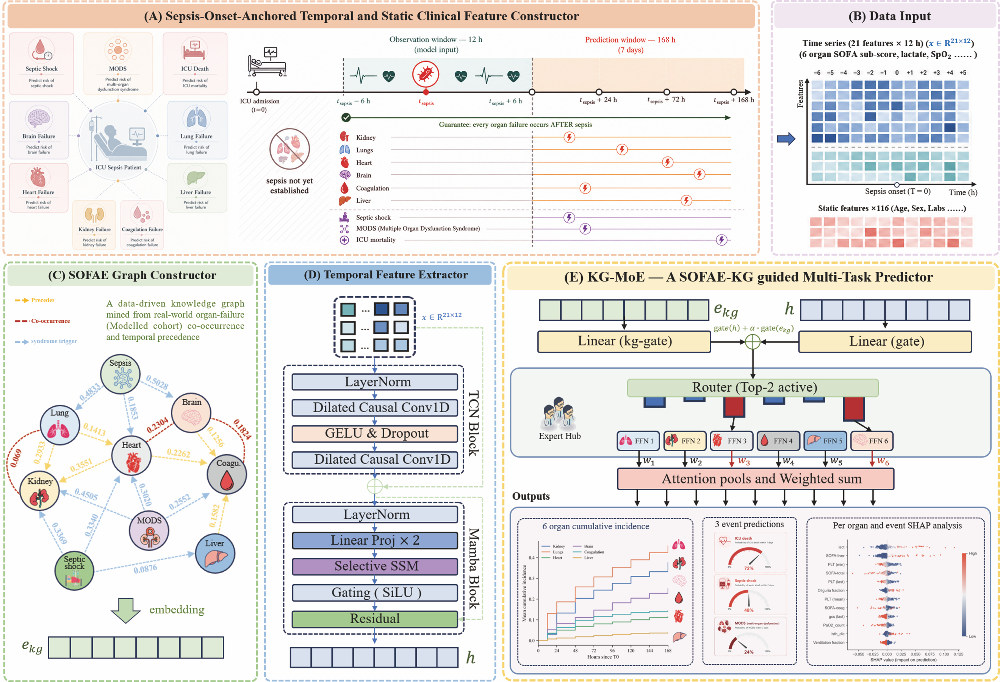
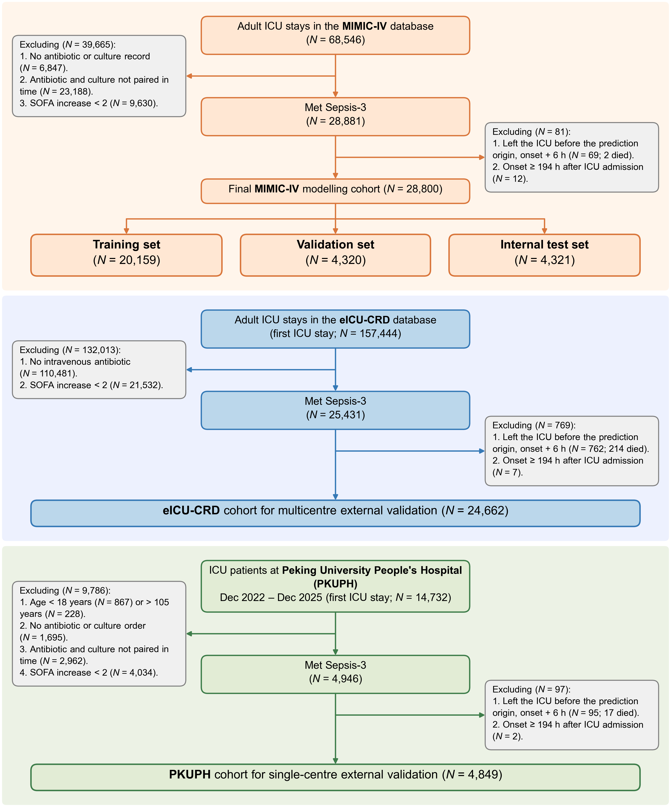
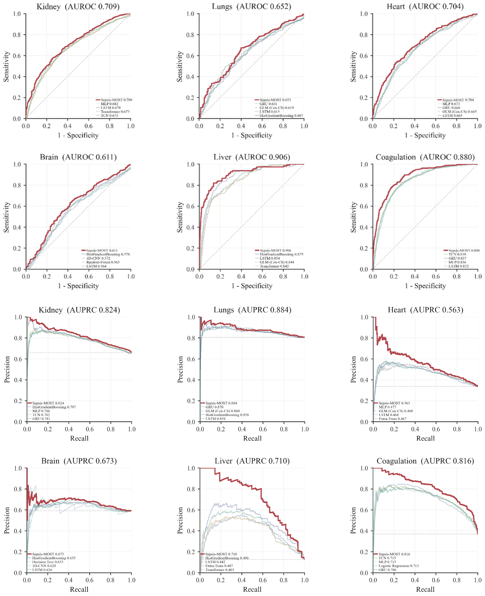
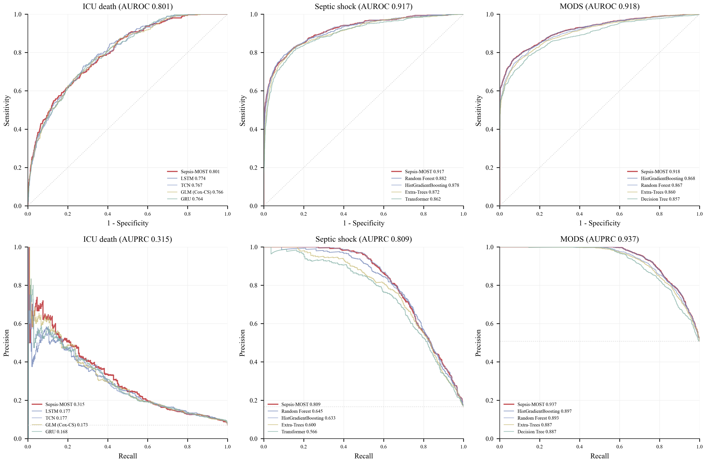
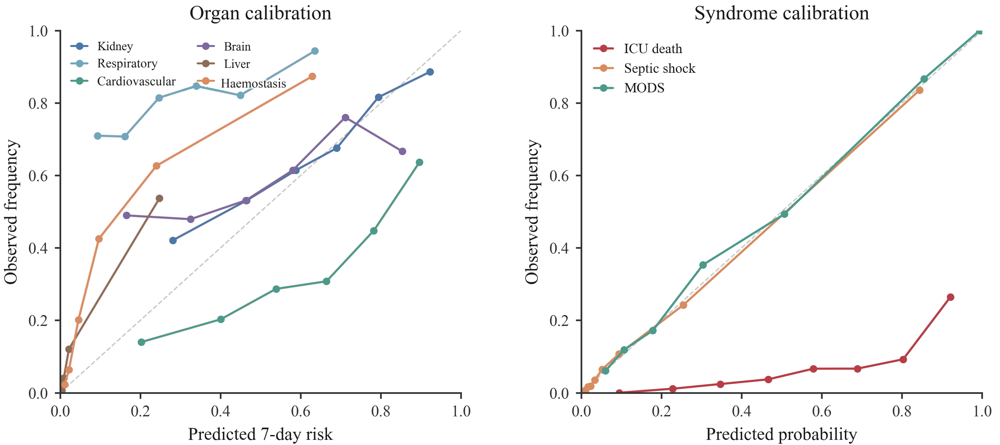
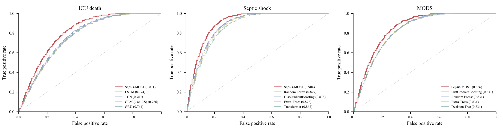
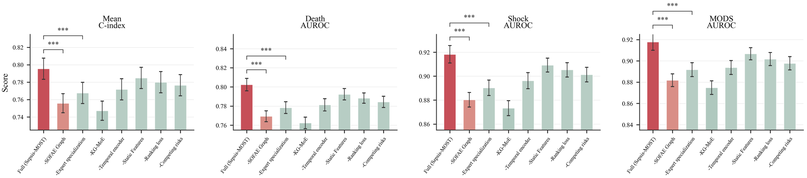
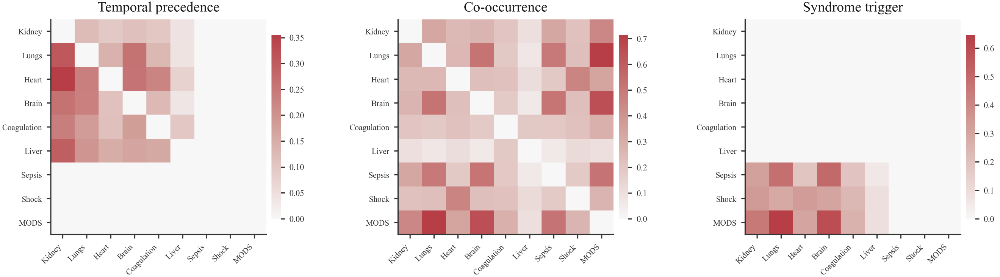
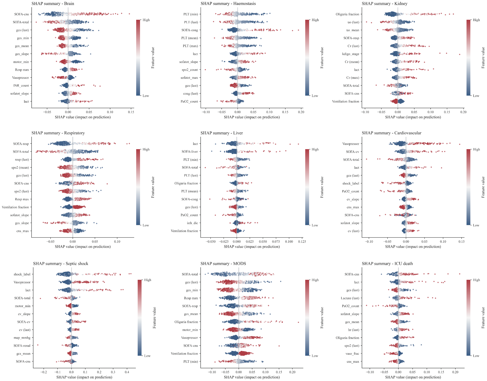
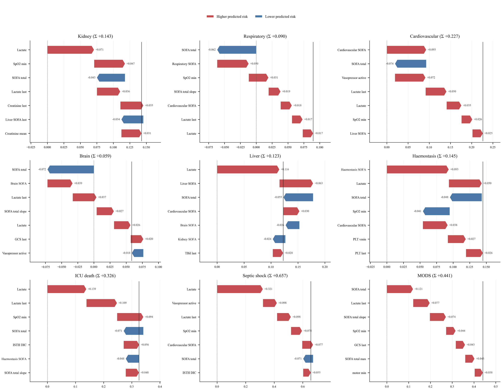

<div align="center">

# Sepsis-MOST

**Knowledge-Graph-Guided Mixture-of-Experts for Organ-Resolved Sepsis Forecasting**

[](#research-overview)
[](#clinical-scope)
[](#cohort-design)
[](#repository)

<sub>longitudinal EHR · organ crosstalk · competing risks · multi-task learning · external validation</sub>

</div>

<p align="center">
  
</p>

Developed in collaboration with **Peking University People's Hospital**, Sepsis-MOST is a clinical forecasting framework for modelling the short-term progression of sepsis across interconnected organ systems. It uses longitudinal ICU records to estimate organ-resolved failure risk together with septic shock, multiple organ dysfunction syndrome and ICU mortality.

The project addresses the gap between describing current illness severity and anticipating what may happen next. Instead of treating each endpoint as an isolated prediction problem, Sepsis-MOST combines temporal representation learning, a data-derived organ-event graph and organ-specialised experts within a unified competing-risk framework.

## At a glance

<table align="center">
  <thead>
    <tr align="center">
      <th>Clinical setting</th>
      <th>Input</th>
      <th>Core model</th>
      <th>Outputs</th>
    </tr>
  </thead>
  <tbody>
    <tr align="center">
      <td>Adult ICU patients<br>meeting Sepsis-3</td>
      <td>Onset-aligned<br>longitudinal EHR</td>
      <td>Temporal encoder<br>SOFAE graph · MoE</td>
      <td>Six organ risks<br>three adverse events</td>
    </tr>
  </tbody>
</table>

<table align="center">
  <thead>
    <tr align="center">
      <th>Development</th>
      <th>External validation</th>
      <th>Clinical collaboration</th>
      <th>Public release</th>
    </tr>
  </thead>
  <tbody>
    <tr align="center">
      <td>MIMIC-IV</td>
      <td>eICU-CRD · PKUPH</td>
      <td>Peking University<br>People's Hospital</td>
      <td>Architecture · figures<br>aggregate tables</td>
    </tr>
  </tbody>
</table>

## Research overview

Sepsis-MOST follows the clinical trajectory from sepsis onset to subsequent organ failure and adverse events. The framework preserves the identity of each organ-specific task while allowing shared temporal patterns and learned organ relationships to inform joint prediction.

Its main research contributions are a unified multi-outcome formulation, graph-guided expert specialisation, explicit competing-risk modelling and multicohort evaluation without site-specific retraining. The current repository presents the study design, model specification and manuscript figures; implementation release remains staged.

## Clinical scope

The prediction space covers kidney, lung, cardiovascular, neurological, coagulation and liver failure, together with septic shock, multiple organ dysfunction syndrome and ICU mortality.

<p align="center">
  
  <br>
  <sub>Organ-failure and adverse-event definitions used by the study.</sub>
</p>

## Cohort design

Model development and evaluation span a US single-centre critical-care database, a US multicentre database and an independent hospital cohort from China. The external cohorts are reserved for evaluating the frozen model across distinct clinical environments.

<p align="center">
  
  <br>
  <sub>Cohort selection and analysis roles across the three study populations.</sub>
</p>

## Model design

The framework connects onset-aligned feature construction, temporal representation learning, a Sepsis-associated Organ Failure and Adverse Event graph, organ-specialised expert routing and task-specific prediction heads. ICU death is represented as a competing event for the organ-failure tasks.

<p align="center">
  
  <br>
  <sub>End-to-end computational framework.</sub>
</p>

The module-level specification and planned release structure are provided in [`ARCHITECTURE.md`](ARCHITECTURE.md).

## Evaluation overview

The study evaluates organ-specific discrimination, adverse-event discrimination and calibration within the held-out development cohort, followed by frozen-model transfer to the external cohorts.

<p align="center">
  
  <br>
  <sub>Internal organ-failure discrimination.</sub>
</p>

<p align="center">
  
  <br>
  <sub>Internal adverse-event discrimination.</sub>
</p>

<p align="center">
  
  <br>
  <sub>Calibration across organ-failure and adverse-event targets.</sub>
</p>

<p align="center">
  
  <br>
  <sub>External adverse-event discrimination in eICU-CRD.</sub>
</p>

## Model analysis

Component studies, learned graph relations and attribution analyses examine how graph guidance, expert specialisation and the temporal representation contribute to the final predictions.

<p align="center">
  
  <br>
  <sub>Component analysis of the full framework.</sub>
</p>

<p align="center">
  
  <br>
  <sub>Data-derived organ and adverse-event relations.</sub>
</p>

<p align="center">
  
  <br>
  <sub>Global feature attribution across the prediction targets.</sub>
</p>

<p align="center">
  
  <br>
  <sub>Patient-level decomposition of model predictions.</sub>
</p>

Aggregate result tables and a compact evidence summary are available in [`RESULTS.md`](RESULTS.md).

## Repository

```text
SepsisMOST/
├── assets/figures/                 # manuscript architecture and result figures
├── configs/
│   ├── cohorts/                    # cohort and endpoint specifications
│   ├── evaluation/                 # validation protocols
│   └── model/                      # model configuration contracts
├── results/tables/                 # aggregate published results
├── scripts/
│   ├── build/                      # future cohort and graph construction
│   ├── train/                      # future model training entry points
│   └── evaluate/                   # future validation workflows
├── src/sepsis_most/
│   ├── clinical/                   # cohorts, endpoints and harmonisation
│   ├── graph/                      # SOFAE relations and embeddings
│   ├── model/                      # encoders, experts, routing and heads
│   ├── objectives/                 # multi-task and competing-risk objectives
│   ├── training/                   # optimisation and calibration
│   ├── evaluation/                 # discrimination, calibration and transfer
│   └── interpretability/           # graph and feature attribution
├── tests/                          # future unit, integration and statistical tests
├── ARCHITECTURE.md
├── RESULTS.md
└── README.md
```

The repository does not contain patient-level data, protected health information, model weights or source implementation. Public clinical datasets remain subject to their original credentialing and data-use requirements, and the institutional cohort is not redistributed.
